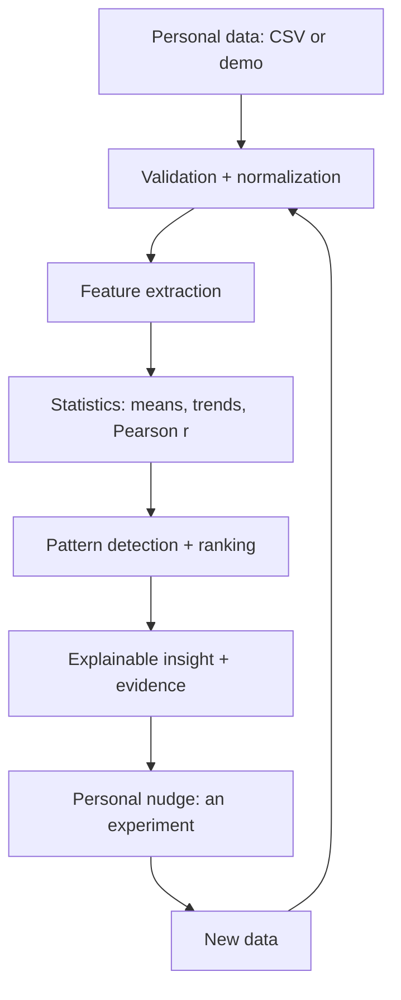

# Know Thyself

**Your data. Your intelligence.**

A personal intelligence tool that finds the patterns in your own wellness data, shows the evidence, and turns them into small experiments you can try. Everything runs in your browser.

## Problem

Phones, watches and trackers record sleep, steps, heart rate and screen time, but they give you disconnected numbers, not understanding. People have data without insight.

## Solution

Know Thyself is a personal intelligence layer. It validates your data, extracts features, tests relationships with simple statistics, ranks what it finds, and explains each finding with its evidence. Language only describes the results; the engine finds the facts, so insights are never invented.

## Key features

- **Overview:** a headline finding, key metrics with sparklines, and a ranked "What affects your sleep / recovery?" chart of correlations. Tap any factor to see the evidence.
- **Insights ("Things I discovered about you"):** the strongest findings, ranked by statistical strength, effect size and sample coverage. Each has a "Why am I seeing this?" panel showing the method, sample size, data used and limitations.
- **Trends:** 7D / 30D charts, each answering one question.
- **Nudges as small experiments:** generated from your own patterns, not a script. Try one and see whether your data changes.
- **Ask your data:** questions like "Why was my sleep worse this week?" are interpreted, computed on the loaded dataset, and answered with the evidence shown.
- **Import your own data:** upload a CSV and the whole app re-analyzes it.
- **How it works:** a visual walkthrough of the pipeline.
- **Privacy by design:** local processing, with delete and reset options.
- **Optional modules, off by default:** cycle-aware insights and sport sessions (see below).

## Import your own CSV

Use "Import your data" and upload a CSV. The importer is built for messy real-world files:

- **Column detection** by header keywords (date, sleep, bedtime, late-night screen, screen time, steps, recovery, resting HR, workout). Only a date column is required.
- **Normalization:** sleep and screen values in hours are converted to minutes, bedtimes like `23:30` are converted relative to 10 PM, and workout values accept yes/no/true/1.
- **Validation report:** valid days, date range, detected columns, and counts of bad rows, duplicate dates and missing values. Bad rows are skipped and invalid values are left empty rather than guessed.
- **Minimum data:** at least 7 valid days are needed to look for patterns.
- **"Try a messy sample file"** downloads a deliberately flawed CSV so you can see the validation in action.

## Optional modules (off by default)

Both modules have their own tab and stay off until the user turns them on. While off, nothing about them is read or analyzed. Each can be turned off and cleared at any time, and their data is handled locally like everything else.

### Cycle-aware insights

- Compares your own sleep, recovery, steps and energy across cycle phases (menstrual, follicular, ovulatory, luteal) and surfaces the biggest difference as a normal insight with "Why am I seeing this?".
- Gives a gentle suggestion for today based on the average recovery in your current phase, and a "test it next cycle" experiment.
- Optional self-reported conditions (PCOS / PCOD, thyroid condition, pre-diabetes / insulin resistance) only change the interpretation notes shown, such as "phase labels are approximate" or "some of this may not be cycle-related". They never produce diagnoses or treatment advice.
- Data: the demo includes a synthetic cycle. For your own CSV, add a `cycle_day` column (1 = first day of period) and optionally `energy` (1 to 5).

### Sport sessions

- Log basketball, tennis or cricket sessions (minutes and effort 1 to 10). Training load = minutes × effort.
- Shows the last 7 days against your usual weekly load, how next-day recovery looks after harder vs lighter sessions, and a suggested target for the next 7 days (within about 10% of your usual load).
- Not measured: spatial awareness and decision-making. These need video or sensor analysis, not ordinary phone or watch data, so they are listed as future work.

## Intelligence engine

Statistics first, language second.

| Step | What it does |
| --- | --- |
| Validation and normalization | Cleans the data, fixes units, reports problems |
| Feature extraction | Builds metrics such as bedtime consistency and late-night screen use |
| Correlation | Pearson r between metrics (needs enough overlapping days; weak or flat relationships are ignored) |
| Group comparison | Median split, e.g. nights with high vs low late-night screen time |
| Trend detection | Last 7 days vs the previous 7 days |
| Anomaly detection | Resting heart rate above your own baseline plus a standard-deviation threshold, several days in a row |
| Ranking | Findings scored by strength, size and sample coverage |
| Nudges | The strongest pattern becomes a small, testable experiment |

Every finding is an association, not a cause, and the interface says so.



## Privacy

- All processing happens locally in your browser. Imported files are never uploaded.
- Only derived insights are shown; raw rows stay on your device.
- **Delete my data** and **Reset demo data** are built in.
- Cycle and hormonal data is only used if the user opts in, and can be cleared at any time.
- This build has no LLM connected. A future optional AI explanation layer would receive derived evidence only, never raw data.

## Safety

Wellness insights only. Not medical advice, and no diagnoses. Findings are associations, not causes. If something worries you, talk to a health professional.

## Tech stack

- Single self-contained HTML file, vanilla JavaScript, inline SVG charts
- No frameworks, no build step, no dependencies, no network requests

## Running locally

1. Download `know-thyself-v2.html` (rename to `index.html` if you like).
2. Open it in any modern browser.

Or serve it:

```bash
python3 -m http.server 8000
# open http://localhost:8000/know-thyself-v2.html
```

## Demo (2–3 minutes)

1. **Overview:** the headline finding and the ranked "what affects your sleep" chart.
2. **Insights:** open a finding and show "Why am I seeing this?" (method, sample size, limits).
3. **Import:** upload a CSV (or the messy sample) and show the validation report and re-analysis.
4. **Ask:** "Why was my sleep worse this week?"
5. **Nudges:** a small experiment generated from the data.
6. **How it works:** the pipeline and the privacy story.

## Future vision (not implemented)

- Direct integrations: Apple Health, Google Health Connect, Garmin, Fitbit, Oura
- An optional LLM explanation layer fed with derived evidence only
- Video or sensor-based sport analysis (movement, decision-making) for sessions
- Cycle tracking from real logs and wearables, with longer history per phase
- Longer-term tracking so experiments can be compared over weeks

## Honest scope

The demo dataset, including the demo cycle and sport sessions, is synthetic. Imported CSVs are analyzed for real, but this is an MVP, not a production health platform.
